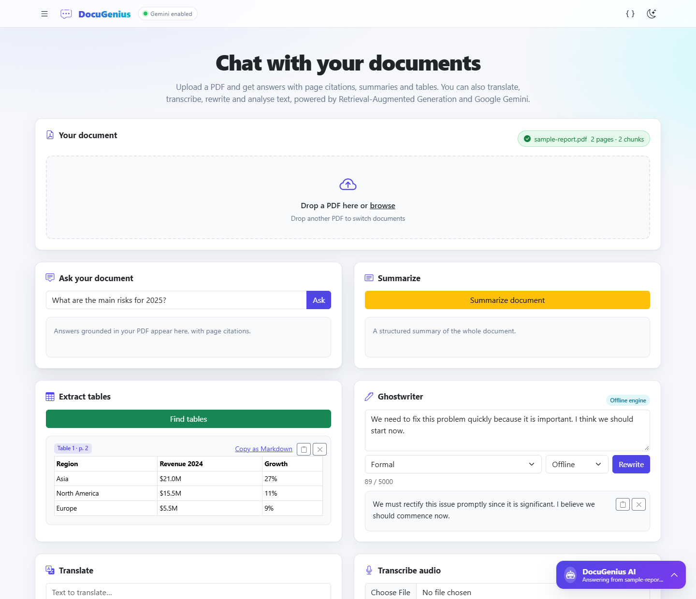
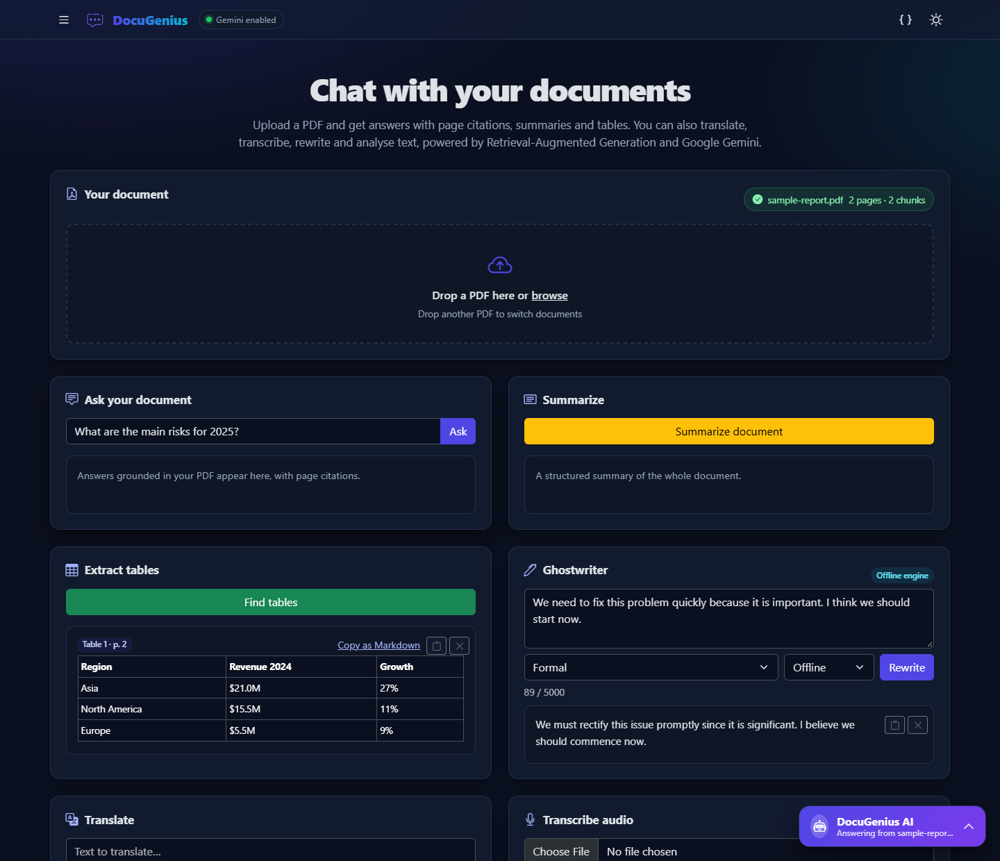
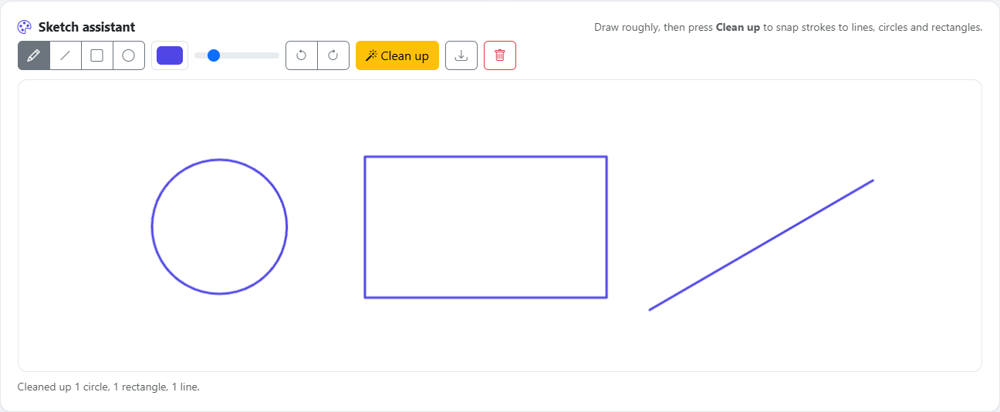
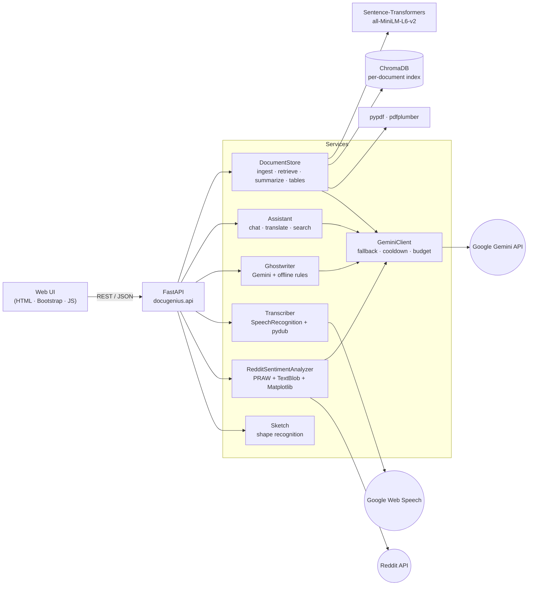
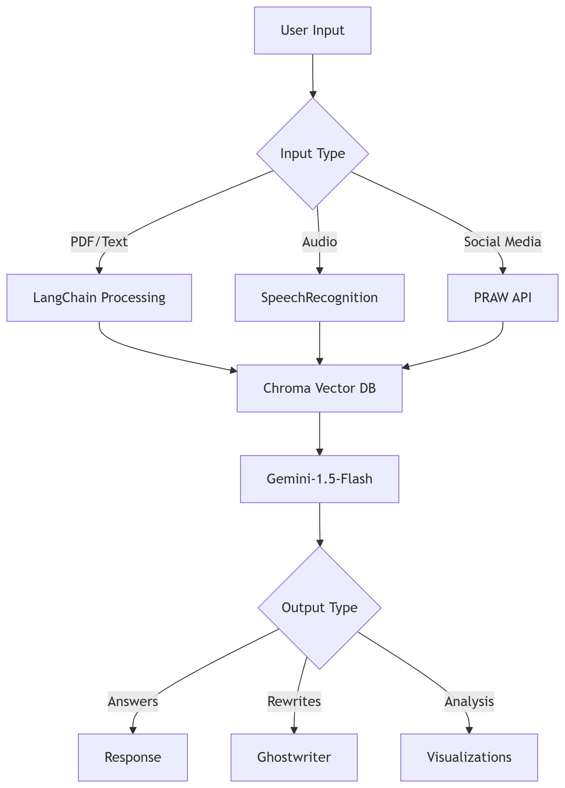
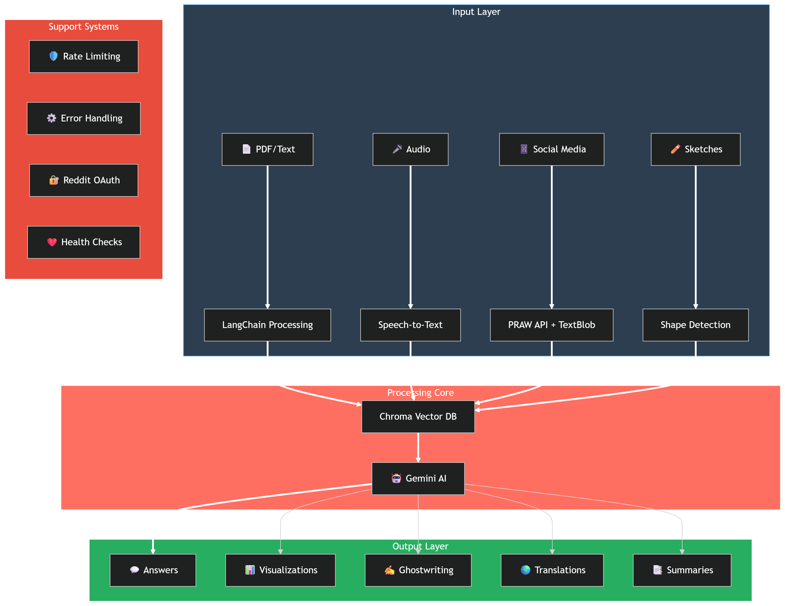
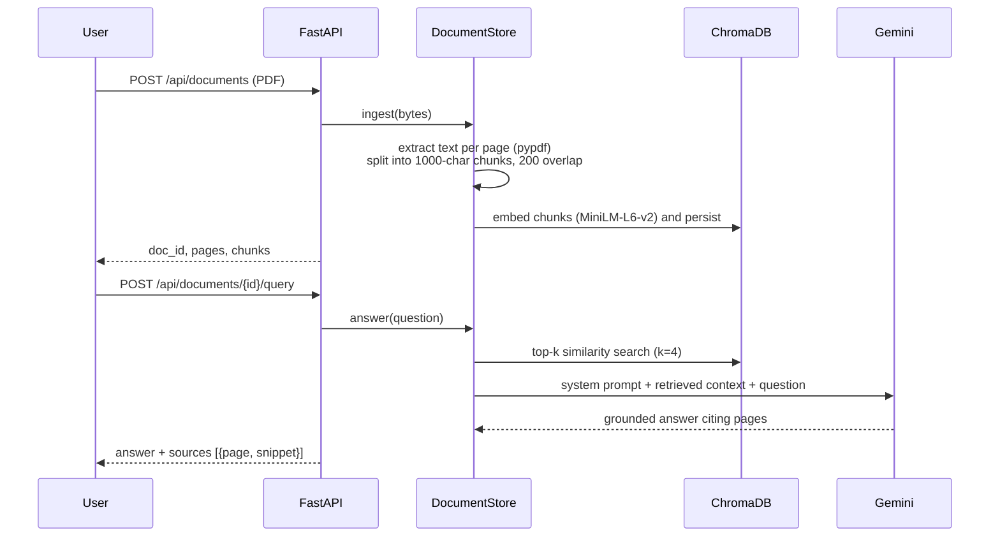

<div align="center">

# DocuGenius: AI PDF Chatbot & NLP Document Assistant

**Chat with your PDFs, Word documents, text and Markdown files and get answers that cite their sources, using Retrieval-Augmented Generation (RAG) with LangChain, ChromaDB, Sentence-Transformers and Google Gemini on FastAPI.**

[](https://github.com/Kianis534/docugenius-ai-pdf-chatbot/actions/workflows/ci.yml)


[](LICENSE)

[Features](#features) · [Quick start](#quick-start) · [Architecture](#architecture) · [API](#rest-api) · [Deployment](#deployment) · [FAQ](#troubleshooting--faq)



</div>

---

DocuGenius turns your documents into something you can talk to. Upload a report, paper, contract or manual as a PDF, Word (.docx), text or Markdown file, then ask questions in plain language. The answers come only from your document and cite the pages or sections they're based on. Around that core RAG pipeline sit a set of practical NLP tools: summarization, table extraction, translation, speech-to-text, writing-style transfer, Reddit sentiment analysis and a shape-recognizing sketch pad. All of them are served by one documented REST API and a lightweight web UI.

It started as my semester project for a Natural Language Processing course. Since then I've rebuilt it into a modular, tested, containerized application.

## Table of contents

- [Features](#features)
- [Screenshots](#screenshots)
- [Architecture](#architecture)
- [How the RAG pipeline works](#how-the-rag-pipeline-works)
- [Tech stack](#tech-stack)
- [Quick start](#quick-start)
- [Getting your API keys](#getting-your-api-keys)
- [Configuration](#configuration)
- [Usage guide](#usage-guide)
- [REST API](#rest-api)
- [Deployment](#deployment)
- [Project structure](#project-structure)
- [Testing and code quality](#testing-and-code-quality)
- [Troubleshooting / FAQ](#troubleshooting--faq)
- [Security and privacy](#security-and-privacy)
- [Roadmap](#roadmap)
- [Contributing](#contributing)
- [License](#license)
- [Author](#author)

## Features

### Document intelligence (RAG)
- **Chat with PDF, Word, TXT and Markdown**: ask natural-language questions and get answers grounded in the document, with **page citations** (or section citations for non-PDF files) and the matching passages.
- **Semantic search**: local `all-MiniLM-L6-v2` embeddings and a persistent **ChromaDB** index per document (cosine similarity).
- **Whole-document summaries**: chunks are sampled evenly from start to finish, so long files are summarized end to end, not just the first pages.
- **Table extraction**: ruled PDF tables are detected with **pdfplumber**, Word tables are read natively and Markdown pipe tables are parsed. All are shown as HTML, with one-click copy as Markdown.
- **Instant re-uploads**: documents are content-addressed by SHA-256, so the same file is never indexed twice.
- **You control your data**: remove a document, its vector index and cached results from the server with one click (or `DELETE /api/documents/{id}`).

### AI assistant
- **Multi-turn chat widget** that remembers the conversation and switches to document mode automatically once a PDF is loaded.
- **Translation** into 100+ languages, preserving formatting, names and numbers.
- **Web search** with Google Search grounding and source links when your Gemini tier supports it. Otherwise it answers from model knowledge and says so.
- **Resilient Gemini client**: automatic fallback across models, cooldowns for rate-limited or retired models, an optional daily request budget, and clear error messages.

### Classic NLP tools
- **Ghostwriter (style transfer)**: rewrite text as formal, concise, casual, academic, legal, technical, creative or a 280-character social post. It uses Gemini when available and falls back to an **offline rule-based engine**. That engine does part-of-speech-aware synonym substitution with verb inflection, noun pluralization, contraction handling and noun/verb disambiguation.
- **Speech-to-text**: transcribe WAV, MP3, M4A, OGG or WEBM audio in several languages.
- **Reddit sentiment analysis**: collect posts and top comments on any topic, score them with TextBlob polarity, and get a donut chart, top subreddits, representative posts and AI-written insights.
- **Sketch assistant**: draw roughly and it snaps strokes to clean lines, circles and rectangles, using closure, straightness and radial-variance features plus Chaikin smoothing.

### Engineering
- Clean, layered **FastAPI** backend: routes, Pydantic schemas, framework-agnostic services, typed domain errors.
- **Interactive OpenAPI docs** at `/docs`, with request and response models for every endpoint.
- **109 automated tests** that run offline in seconds (Gemini, Reddit and speech are faked), plus Ruff linting and formatting, enforced in **GitHub Actions**.
- **Production Docker image**: multi-stage build, CPU-only PyTorch, non-root user, embedding model baked in, healthcheck.
- **Secure by default**: no secrets in code, all rendered output escaped or sanitized (XSS-safe), only the frontend assets folder is served, uploads are size- and type-validated.
- **Accessible, responsive UI** with dark mode, keyboard shortcuts and no build step.

## Screenshots

| Dark mode | Sketch assistant |
| --- | --- |
|  |  |

## Architecture



Each service is plain Python with no FastAPI imports, so it can be unit-tested or reused on its own. The API layer only validates input, calls a service and maps results to response models. Services raise typed errors (`DocumentNotFoundError`, `LLMQuotaError` and others), and these become consistent `{"detail": "..."}` responses with the right HTTP status codes.

<details>
<summary>Original architecture diagrams (from the course project)</summary>

| Request flow | Layered view |
| --- | --- |
|  |  |

</details>

## How the RAG pipeline works



1. **Extraction**: `pypdf` reads PDFs page by page and keeps the page number as metadata. Word files are read with `python-docx` (paragraphs and tables), and text or Markdown files are decoded directly (UTF-8, UTF-16 or Windows-1252). Non-PDF text is grouped into numbered sections of roughly one page, which become the citation unit. Encrypted, corrupted, scanned (image-only) and unsupported files are rejected with a helpful message.
2. **Chunking**: LangChain's `RecursiveCharacterTextSplitter` makes overlapping chunks, so sentences at chunk edges aren't lost.
3. **Embedding**: `sentence-transformers/all-MiniLM-L6-v2` turns each chunk into a normalized 384-dimensional vector. It runs locally, so no embedding API is needed.
4. **Indexing**: each document gets its own persistent Chroma collection under `DATA_DIR/documents/<doc_id>/`.
5. **Retrieval**: the question is embedded and the `RETRIEVAL_K` most similar chunks are fetched.
6. **Generation**: Gemini is told to answer **only** from that context, cite pages, and say so when the answer isn't in the document. This keeps hallucination to a minimum.

## Tech stack

| Layer | Technology |
| --- | --- |
| API | FastAPI, Uvicorn, Pydantic v2, pydantic-settings |
| LLM | Google Gemini via the `google-genai` SDK (default `gemini-3.8-flash`, with fallbacks) |
| RAG | LangChain (core, text-splitters, Chroma, Hugging Face integrations), ChromaDB, Sentence-Transformers |
| Documents | pypdf, pdfplumber, python-docx |
| NLP and audio | TextBlob, SpeechRecognition, pydub/FFmpeg |
| Social and charts | PRAW (Reddit API), Matplotlib |
| Frontend | HTML5, Bootstrap 5.3 (colour modes), vanilla JavaScript, marked + DOMPurify, Lottie |
| Quality | Pytest, Ruff, GitHub Actions, Dependabot |
| Delivery | Docker (multi-stage, non-root), Hugging Face Spaces ready |

## Quick start

### Prerequisites

- **Python 3.11 or 3.12**
- A free **Google Gemini API key** (see [Getting your API keys](#getting-your-api-keys))
- *Optional:* [FFmpeg](https://ffmpeg.org/download.html) for MP3/M4A/OGG transcription (WAV works without it)
- *Optional:* Reddit API credentials for the sentiment analysis feature

### 1. Clone the repository

```bash
git clone https://github.com/Kianis534/docugenius-ai-pdf-chatbot.git
cd docugenius-ai-pdf-chatbot
```

### 2. Create a virtual environment and install dependencies

macOS / Linux:

```bash
python3 -m venv .venv
source .venv/bin/activate
pip install torch --index-url https://download.pytorch.org/whl/cpu
pip install -r requirements.txt
```

Windows (PowerShell):

```powershell
python -m venv .venv
.venv\Scripts\Activate.ps1
pip install torch --index-url https://download.pytorch.org/whl/cpu
pip install -r requirements.txt
```

> The first command installs CPU-only PyTorch, which is about 2 GB smaller than the default CUDA build. If you have an NVIDIA GPU and want to use it, install the regular `torch` package instead.

### 3. Add your own API keys

This repository ships **without any API keys**. Copy the template and paste in your own:

```bash
cp .env.example .env        # Windows: copy .env.example .env
```

```dotenv
GOOGLE_API_KEY=your-gemini-api-key
# optional, only for Reddit sentiment analysis
REDDIT_CLIENT_ID=your-reddit-client-id
REDDIT_CLIENT_SECRET=your-reddit-client-secret
REDDIT_USER_AGENT=python:docugenius:v2.0 (by /u/your_reddit_username)
```

`.env` is listed in `.gitignore`, so your keys stay on your machine.

### 4. Run the app

```bash
python -m docugenius
```

Open **http://127.0.0.1:7860** for the web app and **http://127.0.0.1:7860/docs** for the interactive API docs.

> The first PDF upload downloads the embedding model (about 90 MB) once. After that, uploads take a few seconds.

Useful variations: `PORT=8000 python -m docugenius` changes the port, `HOST=0.0.0.0` exposes the server on your network, and `RELOAD=true` auto-reloads while you develop. You can also run Uvicorn directly with `uvicorn docugenius.main:app --reload --port 7860`.

## Getting your API keys

**Google Gemini (required for AI features)**
1. Go to [Google AI Studio → API keys](https://aistudio.google.com/app/apikey) and sign in with a Google account.
2. Click **Create API key** and copy it.
3. Paste it into `.env` as `GOOGLE_API_KEY=...` and restart the server.

The free tier is enough for personal use. It is rate-limited, and DocuGenius automatically falls back to the next model when one is throttled. Live Google Search grounding for the Web search tool needs a paid tier.

**Reddit (optional, for sentiment analysis)**
1. Open [reddit.com/prefs/apps](https://www.reddit.com/prefs/apps) and click **create another app…**.
2. Choose **script**, enter any name, and use `http://localhost:7860` as the redirect URI (it isn't used, because the app runs read-only).
3. The string under the app name is your `REDDIT_CLIENT_ID`. The **secret** is your `REDDIT_CLIENT_SECRET`.
4. Set `REDDIT_USER_AGENT` to something descriptive that includes your Reddit username, as Reddit's API rules require.

## Configuration

All settings are environment variables. A local `.env` file is loaded automatically. See [`.env.example`](.env.example).

| Variable | Default | Description |
| --- | --- | --- |
| `GOOGLE_API_KEY` | *(empty)* | Gemini API key. Without it, AI features return a clear "not configured" message and everything else keeps working. |
| `GEMINI_MODEL` | `gemini-3.8-flash` | Primary model. |
| `GEMINI_FALLBACK_MODELS` | `gemini-3.6-flash,gemini-3.5-flash-lite` | Comma-separated fallbacks, tried in order on rate limits, outages or retired models. |
| `GEMINI_TEMPERATURE` | `0.3` | Default sampling temperature (each feature tunes its own). |
| `GEMINI_TIMEOUT_SECONDS` | `60` | Per-request timeout. |
| `GEMINI_DAILY_REQUEST_LIMIT` | `0` | Optional app-side daily cap to protect a shared key (`0` = unlimited). Resets at 00:00 UTC. |
| `REDDIT_CLIENT_ID` / `REDDIT_CLIENT_SECRET` | *(empty)* | Reddit script-app credentials. |
| `REDDIT_USER_AGENT` | `python:docugenius:v2.0 (by /u/your_reddit_username)` | Descriptive user agent required by Reddit. |
| `EMBEDDING_MODEL` | `sentence-transformers/all-MiniLM-L6-v2` | Any Sentence-Transformers model from the Hugging Face Hub. |
| `CHUNK_SIZE` / `CHUNK_OVERLAP` | `1000` / `200` | Chunking parameters (characters). |
| `RETRIEVAL_K` | `4` | Number of chunks retrieved per question. |
| `MAX_UPLOAD_MB` | `20` | Maximum PDF size. |
| `DATA_DIR` | system temp folder + `/docugenius` | Where PDFs and vector indexes are stored. Point it at a persistent volume in production. |
| `ALLOWED_ORIGINS` | `*` | Comma-separated CORS origins. Set this to your domain in production. |
| `LOG_LEVEL` | `INFO` | `DEBUG`, `INFO`, `WARNING` or `ERROR`. |
| `HOST` / `PORT` | `127.0.0.1` / `7860` | Bind address for `python -m docugenius`. |

> **Model names change.** Google retires Gemini models regularly. If a model is shut down, DocuGenius skips it automatically, but you can set `GEMINI_MODEL` to any current model from the [Gemini models page](https://ai.google.dev/gemini-api/docs/models).

## Usage guide

| Tool | How to use it | Needs Gemini key |
| --- | --- | :---: |
| **Upload** | Drag a PDF, Word (.docx), text or Markdown file onto the drop zone or click *browse*. The badge shows pages (or sections) and chunks once it's indexed. | No |
| **Remove** | Click the × next to the document name to delete it, its index and cached results from the server. | No |
| **Ask your document** | Type a question and press *Ask*. Expand *Sources* to see the exact passages and their pages or sections. | Yes |
| **Summarize** | One click gives an overview, key points and a takeaway for the whole document. | Yes |
| **Extract tables** | Finds ruled PDF tables (up to 100 pages), Word tables and Markdown pipe tables. Use *Copy as Markdown* to paste them anywhere. | No |
| **Ghostwriter** | Paste text (or select text in any answer to send it here), pick a style and an engine (*Auto*, *Gemini* or *Offline*). | Optional |
| **Translate** | Enter text and any target language, e.g. *Urdu*, *Arabic*, *Spanish*. | Yes |
| **Transcribe audio** | Upload a recording (up to 5 minutes) and pick the spoken language. | No |
| **Web search** | Ask anything. Shows source links when the answer is grounded with Google Search. | Yes |
| **Reddit sentiment** | Enter a topic and time range for a sentiment split, chart, top communities, sample posts and insights. | Optional* |
| **Sketch assistant** | Draw with the pen, line, rectangle or circle tool, then press *Clean up*. Undo/redo with Ctrl+Z / Ctrl+Y, and download as PNG. | No |
| **Chat bubble** | Bottom-right corner. General assistant by default, document-aware once a PDF is uploaded. | Yes |

\*Reddit sentiment needs Reddit credentials. Without Gemini, it returns a statistical summary instead of AI insights.

## REST API

Every UI feature is available over HTTP. Full schemas, examples and a *Try it out* button are at **`/docs`** (Swagger UI) and **`/redoc`**.

| Method | Endpoint | Description |
| --- | --- | --- |
| `GET` | `/health` | Service status, configured models, request counters |
| `POST` | `/api/documents` | Upload and index a PDF, DOCX, TXT or Markdown file (`multipart/form-data`, field `file`) |
| `GET` | `/api/documents/{doc_id}` | Document metadata (format, pages or sections, chunks) |
| `DELETE` | `/api/documents/{doc_id}` | Delete a document, its vector index and cached results |
| `POST` | `/api/documents/{doc_id}/query` | RAG question answering with page sources |
| `POST` | `/api/documents/{doc_id}/summary` | Whole-document summary |
| `GET` | `/api/documents/{doc_id}/tables` | Extracted tables (rows and Markdown) |
| `POST` | `/api/chat` | Multi-turn chat, optionally grounded on `doc_id` |
| `POST` | `/api/translate` | Translation |
| `POST` | `/api/search` | Web-grounded answer with sources |
| `POST` | `/api/transcribe` | Speech-to-text (`multipart/form-data`, fields `file`, `language`) |
| `POST` | `/api/reddit/sentiment` | Reddit sentiment analysis |
| `POST` | `/api/ghostwriter` | Style transfer |
| `POST` | `/api/sketch/enhance` | Stroke-to-shape clean-up |

**Example: upload a PDF and ask a question**

```bash
# 1. Upload
curl -F "file=@annual-report.pdf" http://127.0.0.1:7860/api/documents
# {"doc_id":"9ee4fd81557ba75e2f53db78cbb27dc0","filename":"annual-report.pdf","pages":12,"chunks":31,...}

# 2. Ask
curl -X POST http://127.0.0.1:7860/api/documents/9ee4fd81557ba75e2f53db78cbb27dc0/query \
     -H "Content-Type: application/json" \
     -d '{"question": "How much did revenue grow in 2024?"}'
# {"answer":"Revenue grew 18% to $42M (p. 1) ...","sources":[{"page":1,"snippet":"..."}],"model":"gemini-3.8-flash"}
```

**Example: rewrite text offline (no API key needed)**

```bash
curl -X POST http://127.0.0.1:7860/api/ghostwriter \
     -H "Content-Type: application/json" \
     -d '{"text": "We need to fix this problem quickly because it is important.", "style": "formal", "engine": "rules"}'
# {"rewritten":"We must rectify this issue promptly since it is significant.","engine":"rules",...}
```

Errors always look like `{"detail": "human-readable message"}` with a meaningful status code: `404` unknown document, `413` file too large, `422` invalid input or unreadable PDF, `429` quota reached, `502` upstream error, `503` feature not configured.

## Deployment

### Docker

```bash
docker build -t docugenius .
docker run -p 7860:7860 --env-file .env docugenius
```

The image uses CPU-only PyTorch, runs as a non-root user (UID 1000), includes FFmpeg, bakes in the embedding model and exposes a `/health` healthcheck. To keep uploaded documents across restarts, mount a volume:

```bash
docker run -p 7860:7860 --env-file .env -e DATA_DIR=/data -v docugenius-data:/data docugenius
```

### Hugging Face Spaces (free hosting)

1. Create a new **Space** at [huggingface.co/new-space](https://huggingface.co/new-space). Choose the **Docker** SDK, the **Blank** template and **CPU basic** hardware.
2. Push this repository to the Space (or upload the files through *Files → Add file*).
3. Make sure the Space's `README.md` starts with this front matter, which tells Spaces how to run the container:

   ```yaml
   ---
   title: DocuGenius
   emoji: 📄
   colorFrom: indigo
   colorTo: blue
   sdk: docker
   app_port: 7860
   license: mit
   ---
   ```

4. Under **Settings → Variables and secrets**, add `GOOGLE_API_KEY` as a **secret**, plus the optional Reddit secrets.
5. Watch the **Logs** tab go from *Building* to *Running*, then open the **App** tab.

Set `GEMINI_DAILY_REQUEST_LIMIT` on public demos so visitors can't use up your quota.

### Other platforms

The same image runs on Google Cloud Run, Render, Railway, Fly.io, Azure Container Apps or any VM. Expose port `7860` (or set `PORT`), pass the environment variables as secrets, and point `DATA_DIR` at persistent storage if you want documents to survive restarts.

## Project structure

```text
docugenius-ai-pdf-chatbot/
├── docugenius/                  # Python package (backend)
│   ├── __main__.py              # `python -m docugenius` entry point
│   ├── main.py                  # FastAPI app factory, middleware, static files
│   ├── api.py                   # HTTP routes
│   ├── schemas.py               # Pydantic request/response models
│   ├── config.py                # Environment-driven settings
│   ├── errors.py                # Domain errors -> HTTP status codes
│   └── services/
│       ├── llm.py               # Gemini client: fallback, cooldowns, budget, grounding
│       ├── documents.py         # PDF/DOCX/TXT/MD ingestion, RAG Q&A, summaries, tables, deletion
│       ├── assistant.py         # Chat, translation, web search
│       ├── ghostwriter.py       # Style transfer: Gemini + offline rule-based engine
│       ├── speech.py            # Speech-to-text
│       ├── reddit.py            # Reddit sentiment analysis and charts
│       └── sketch.py            # Geometric shape recognition
├── frontend/
│   ├── index.html               # Single-page UI
│   └── assets/                  # CSS, JS, Lottie animation, diagrams
├── tests/                       # Pytest suite (offline, fakes for external APIs)
├── docs/images/                 # README screenshots
├── .github/                     # CI workflow, Dependabot, issue and PR templates
├── Dockerfile
├── .env.example                 # Configuration template (no secrets)
├── requirements.txt             # Pinned runtime dependencies
├── requirements-dev.txt         # + test and lint tools
└── pyproject.toml               # Project metadata, pytest and Ruff config
```

## Testing and code quality

```bash
pip install -r requirements-dev.txt
pytest                    # 109 tests, fully offline, well under a minute
ruff check .              # lint
ruff format --check .     # formatting
```

The suite covers every endpoint and the core logic. That includes RAG ingestion and retrieval with real PDFs generated on the fly, pdfplumber table extraction, Gemini fallback, cooldown and quota handling, grounding fallback, the style-transfer rules, shape recognition, input validation, upload limits and path-traversal and static-file exposure checks. GitHub Actions runs lint and tests on Python 3.11 and 3.12. It also builds the Docker image and smoke-tests the running container on every push.

## Troubleshooting / FAQ

<details>
<summary><b>"Gemini is not configured"</b></summary>

Set `GOOGLE_API_KEY` in `.env` (or as an environment variable or secret) and restart the server. The status badge in the header turns green ("Gemini enabled") once a key is set.
</details>

<details>
<summary><b>"Gemini denied access (HTTP 403)" or "rejected the API key"</b></summary>

The key is invalid, has been revoked, or its Google Cloud project has the Generative Language API disabled. Create a new key in [Google AI Studio](https://aistudio.google.com/app/apikey).
</details>

<details>
<summary><b>"The Gemini API quota has been reached" (HTTP 429)</b></summary>

The free tier has per-minute and per-day limits. Wait a minute, or add more models to `GEMINI_FALLBACK_MODELS`, since each model has its own quota.
</details>

<details>
<summary><b>"The Gemini model '…' is not available"</b></summary>

Google has retired that model. Update `GEMINI_MODEL` / `GEMINI_FALLBACK_MODELS` with current names from the [models page](https://ai.google.dev/gemini-api/docs/models).
</details>

<details>
<summary><b>"No selectable text was found in this PDF"</b></summary>

The PDF is a scan (images of pages). Run it through OCR first, for example with `ocrmypdf input.pdf output.pdf`, then upload the result.
</details>

<details>
<summary><b>MP3/M4A transcription fails with "FFmpeg is not installed"</b></summary>

Install FFmpeg (`winget install Gyan.FFmpeg`, `brew install ffmpeg` or `sudo apt install ffmpeg`), or upload a WAV file. The Docker image already includes FFmpeg.
</details>

<details>
<summary><b>The first upload is slow</b></summary>

The embedding model (about 90 MB) is downloaded on first use and cached. The Docker image ships with the model pre-downloaded.
</details>

<details>
<summary><b>Web search answers say "Answered from the model's own knowledge"</b></summary>

Google Search grounding isn't available on the free Gemini tier. DocuGenius detects this and falls back to a normal answer. Use a paid key for live, cited search results.
</details>

<details>
<summary><b>Can I use another LLM (OpenAI, Mistral, a local model)?</b></summary>

All LLM calls go through `docugenius/services/llm.py`. Implement the same `generate()` / `is_configured` / `status()` interface for another provider and wire it up in `Services.build()` (`docugenius/services/__init__.py`).
</details>

## Security and privacy

- **No secrets in the repository.** Keys are read from the environment or a git-ignored `.env`. Never commit real keys. If one leaks, revoke it and create a new one.
- **Data stays on your server**, except the text DocuGenius sends to Google Gemini (questions and retrieved excerpts), Google Web Speech (audio) and Reddit (search queries). Self-host if your documents are confidential.
- **Hardening built in**: XSS-safe rendering (escaping plus DOMPurify), strict input validation, upload size and type checks, document-ID validation against path traversal, and only `frontend/assets` exposed as static files.
- For production, set `ALLOWED_ORIGINS`, `GEMINI_DAILY_REQUEST_LIMIT` and a persistent private `DATA_DIR`, and serve over HTTPS. See [SECURITY.md](SECURITY.md) to report a vulnerability.

## Roadmap

- [x] DOCX, TXT and Markdown ingestion
- [ ] PPTX and HTML ingestion
- [ ] OCR for scanned PDFs (Tesseract / `ocrmypdf`)
- [ ] Multi-document collections and cross-document Q&A
- [ ] Streaming responses (server-sent events)
- [ ] Hybrid retrieval (BM25 + vectors) and re-ranking
- [ ] Optional user accounts and per-user document storage
- [ ] Pluggable LLM providers (OpenAI, Mistral, Ollama)

## Contributing

Contributions are welcome. Please read [CONTRIBUTING.md](CONTRIBUTING.md) for the development setup, coding standards and pull-request checklist. If you find a bug or have an idea, [open an issue](https://github.com/Kianis534/docugenius-ai-pdf-chatbot/issues).

If DocuGenius helps you, a ⭐ on the repo is appreciated and helps others find it.

## License

Released under the [MIT License](LICENSE). You're free to use, modify and distribute it, including commercially.

## Author

**Muhammad Abdullah Raja**, Full-Stack Engineer (web apps, backend systems, APIs, cloud and AI-driven systems)

GitHub: [@Kianis534](https://github.com/Kianis534)

### Acknowledgements

Built with [FastAPI](https://fastapi.tiangolo.com/), [LangChain](https://www.langchain.com/), [ChromaDB](https://www.trychroma.com/), [Sentence-Transformers](https://www.sbert.net/), [Google Gemini](https://ai.google.dev/), [pdfplumber](https://github.com/jsvine/pdfplumber), [TextBlob](https://textblob.readthedocs.io/), [PRAW](https://praw.readthedocs.io/), [SpeechRecognition](https://github.com/Uberi/speech_recognition), [Bootstrap](https://getbootstrap.com/) and [Lottie](https://airbnb.io/lottie/).
